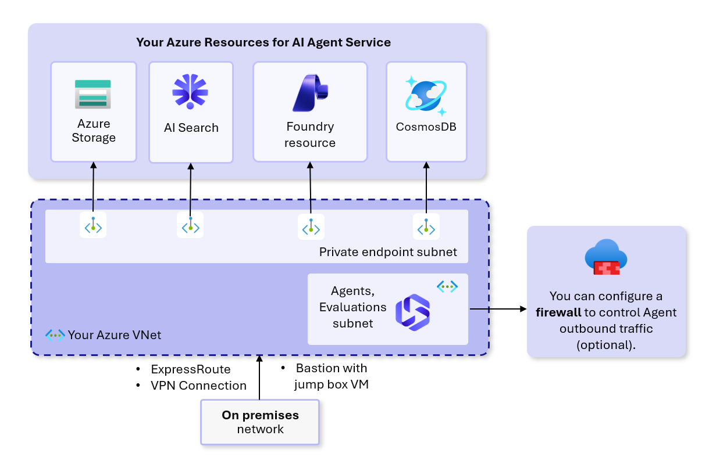
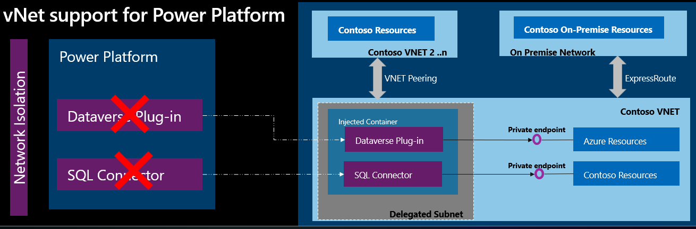

# Copilot Studio and Microsoft Foundry vnet Integration

## Overview

Microsoft Foundry lets you deploy all the Azure resources required to build generative
AI solutions, including the Agent service, in a [private network](https://learn.microsoft.com/en-us/azure/ai-foundry/agents/how-to/virtual-networks?view=foundry-classic).

Further more, Microsoft Power Platform also supports [vnet integration](https://learn.microsoft.com/en-us/power-platform/admin/vnet-support-overview), which enables, for example, agents built in Copilot Studio to
integrate with resources in the vnet where Foundry resources are placed behind private endpoints.

There are, however, a few limitations that may not be obvious until you try.

### Supported scenarios

- ✅ Copilot Studio can access [AI Search as a knowledge source](https://learn.microsoft.com/en-us/microsoft-copilot-studio/knowledge-azure-ai-search). No need to open firewall when setting up the connection in Copilot Studio.
- ✅ Other Copilot Studio [supported services](https://learn.microsoft.com/en-us/power-platform/admin/vnet-support-overview#supported-services) with vnet integration.
- ✅ End-to-end network isolation with Foundry Agent Service network injection in the **Foundry Classic only**
(as of Dec 2025).

### Unsupported scenarios

- ❌ If the Foundry agent service is behind a private endpoint, adding a Foundry agent to a Copilot
Studio agent does not work.
- ❌ If AI Search is behind a private endpoint, adding AI Search as a tool to a Copilot Studio agent
does not work.

## How to set it up

It is quite complex to set up a fully isolated Foundry network environment and integrate it with
Copilot Studio.

1. Set up [isolated network for Foundry](https://learn.microsoft.com/en-us/azure/ai-foundry/agents/how-to/virtual-networks?view=foundry-classic).
1. Set up [virtual network for Power Platform](https://learn.microsoft.com/en-us/power-platform/admin/vnet-support-setup-configure)
In this step, you set up a second vnet in the Power Platform paired region as your Foundry region.
So if your Power Platform environment is in `unitedstates`, your Foundry resources are in `westus`,
the second vnet should be in `eastus`.
1. Since Power Platform can cross regions, in your second vnet, you must also set up the same
private endpoints as the primary Foundry vnet, and associate DNS with these private endpoints.
In other words, the private endpoint subnets and the Power Platform subnets in both vnets should
look same, and private DNS zones must be attached to both.
1. If anything goes wrong, there's limited observability in the admin portal of Power Platform.
Sometimes, it shows everything succeeded even though they didn't. If things don't work, it's critical
to use the [troubleshooting tools](https://learn.microsoft.com/en-us/troubleshoot/power-platform/administration/virtual-network?toc=%2Fpower-platform%2Fadmin%2Ftoc.json&bc=%2Fpower-platform%2Fbreadcrumb%2Ftoc.json).
1. If you changed either vnets or DNS or the Power Platform enterprise network policy, use
[additional Powershell Subnet Injection tools](https://github.com/microsoft/PowerPlatform-EnterprisePolicies?tab=readme-ov-file#how-to-run-subnet-injection-scripts) to remove and re-attach enterprise policies.
